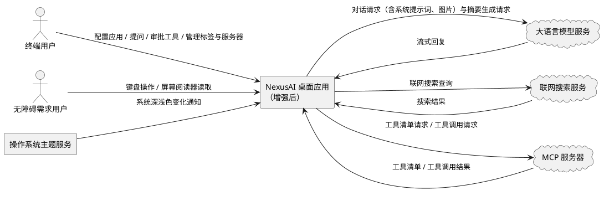
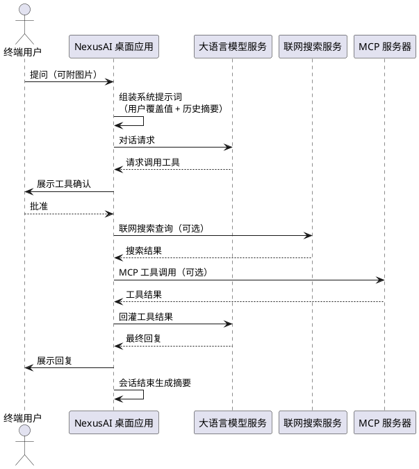

# NexusAI 增强特性需求规格说明书（spec.md）

> **特性名称**：nexus_ai_enhancement
> **文档类型**：需求规格（描述 "What to Build"，不涉及 "How to Build"）
> **需求来源**：15 项研发任务清单（T1–T15）
> **交付基线**：已交付 9 项（T1/T2/T3/T4/T6/T10/T11/T12/T13）、待实现 4 项（T5/T7/T8/T9）、部分交付 1 项（T14）、不排期 1 项（T15）
> **已确认决策**：已交付任务仅做回归验证，不重复开发
> **需求描述规范**：EARS（Easy Approach to Requirements Syntax），触发关键词与固定短语保留英文，变量部分使用中文
> **技术术语约定**：RAG、MVVM、MCP、ReAct、token 等技术术语保留英文原文

---

# 1. 组件定位

## 1.1 核心职责

NexusAI 增强特性负责在既有 MVVM 桌面 AI 助手基础上补齐 15 项能力，实现个性化、能力补全与战略扩展。

## 1.2 核心输入

本特性接收以下外部输入：

1. **用户在设置中心的操作指令**：编辑系统提示词、修改嵌入服务端点、选择主题模式、配置搜索服务提供方与密钥、开关长期记忆、增删改 MCP 服务器配置。
2. **用户在对话区的操作指令**：提问、粘贴或选择图片、审批工具调用、新建/切换/关闭会话标签、导出会话。
3. **操作系统的主题变化信号**：操作系统深浅色设置发生切换时产生的变化通知。
4. **外部服务的响应**：大语言模型服务的流式回复、联网搜索服务的搜索结果、MCP 服务器返回的工具清单与工具调用结果。
5. **应用启动信号**：应用启动时触发日志历史回填、长期记忆检索准备与 MCP 服务器连接。

## 1.3 核心输出

本特性对外产生以下输出：

1. **面向用户的界面呈现**：按语言着色的代码块、英文界面文案、跟随系统变化的主题配色、图片缩略图、多会话标签栏、MCP 服务器管理界面、供辅助技术读取的无障碍信息、标注"历史"的日志条目。
2. **发往外部服务的请求**：携带系统提示词与可选图片附件的模型对话请求、联网搜索查询、MCP 工具调用请求。
3. **持久化数据**：用户设置项、会话摘要、MCP 服务器配置、图片附件。
4. **审计与日志记录**：所有工具调用的审计记录（含来源服务器信息）、可跨重启回填的应用日志。
5. **用户确认提示**：执行有副作用工具前的确认对话框（含服务器名、工具名与参数）。

## 1.4 职责边界

本特性明确不负责以下事项：

1. **不负责大语言模型服务商自身能力的实现**：仅做各服务商消息协议的必要适配，不实现模型推理能力。
2. **不负责 MCP 服务器内部实现与其自身安全性**：仅按 MCP 协议进行客户端侧接入与调用，不对第三方服务器的行为负责。
3. **不引入第三方语法高亮库**：代码高亮能力自研实现（离线、许可证与体积考量）。
4. **不负责 T15（NexusAI 作为 MCP 服务器）**：该任务本期不排期，仅在本文档登记。
5. **不负责操作系统无障碍底层实现**：仅要求应用内控件提供可访问信息与键盘可达性。
6. **不重复开发已交付任务**：T1/T2/T3/T4/T10/T11/T12/T13 仅做回归验证。

---

# 2. 领域术语

**ReAct 循环**
: 智能体"推理—行动—观察"的迭代执行过程；模型在每一步可决定调用工具或给出最终答复。

**系统提示词**
: 每次对话请求中置于最前、用于约束模型行为的指令文本。

**系统提示词覆盖值**
: 用户自定义并用于替代内置系统提示词的文本；为空时表示沿用内置提示词。
: 备注：易混淆项为"内置系统提示词"，后者为应用预置的默认指令文本。

**语法高亮**
: 按编程语言对代码文本中的关键字、字符串、注释等元素赋予不同颜色的展示方式。

**主题模式**
: 应用整体配色的选择，取值包括"跟随系统""深色""浅色"。

**跟随系统（auto）**
: 主题模式的一种，应用配色随操作系统的深浅色设置自动变化。

**本地模式（localOnlyMode）**
: 一种隐私保护模式，开启后禁止将任何数据外发至云端或外部服务。

**联网搜索（web_search）**
: 智能体可调用的一种工具能力，将查询发送至外部搜索服务并获取结果。

**episodic 记忆**
: 跨会话的长期记忆能力，通过保存会话摘要并在新会话中检索注入来维持上下文连续性。
: 备注：区别于单次会话内的短期上下文。

**会话摘要**
: 对一次会话内容压缩生成的精炼文本，作为长期记忆的存储单元。

**日志回填**
: 应用启动时将上一次会话的日志内容重新载入日志面板的机制。

**MCP**
: Model Context Protocol，一种让应用以统一协议接入外部工具服务器的开放协议。

**MCP 服务器**
: 按 MCP 协议对外提供工具集合的外部进程或远程服务。

**MCP 工具**
: 由 MCP 服务器提供、经协议桥接后可被智能体调用的工具。

**不可信数据**
: 来自外部系统、可能包含恶意指令、不得被模型当作指令执行的内容。

**工具确认**
: 在智能体执行有副作用的工具前，向用户展示调用详情并请求批准的过程。

**多标签并行会话**
: 在同一应用窗口内同时运行多个独立会话标签的能力。

**多模态输入**
: 除文本外还包含图片等媒体形式的消息输入。

**无障碍属性**
: 供屏幕阅读器等辅助技术识别控件角色、名称与用途的元信息。

**回归验证**
: 对已交付功能重新执行验证，确认其未因后续变更而退化。

---

# 3. 角色与边界

## 3.1 核心角色

1. **终端用户**：通过界面配置应用、发起对话、审批工具调用、管理会话标签与 MCP 服务器、导出会话内容。
2. **无障碍需求用户**：依赖键盘操作与屏幕阅读器完成核心流程的用户，对控件的可访问信息与焦点顺序有明确依赖。

## 3.2 外部系统

1. **大语言模型服务**：接收携带系统提示词与图片附件的对话请求，返回流式回复；亦用于生成会话摘要。
2. **联网搜索服务**：接收搜索查询，返回标题、链接与摘要片段组成的结果集。
3. **MCP 服务器**：以本地进程或远程端点方式运行，对外提供工具清单与工具调用结果。
4. **操作系统主题服务**：提供系统深浅色设置及其变化通知。

## 3.3 交互上下文

---

# 4. 范围边界

## 4.1 In Scope

1. **已交付任务的回归验证**（T1/T2/T3/T4/T6/T10/T11/T12/T13）：核对行为是否符合本文档需求，确认无回归退化，不重复开发。
2. **待实现任务的新开发**（T5/T7/T8/T9）：主题跟随系统、无障碍属性补全、长期记忆接入、日志跨重启回填。
3. **部分交付任务的补齐**（T14）：在已交付的 MCP 基础能力上补齐不可信数据声明、描述截断、本地模式门控定案与工具清单预算上限。
4. **全局约束**：构建与测试门禁、既有快捷键保持、新增设置项向后兼容、core 层零 UI 依赖。

## 4.2 Out of Scope

1. **T15 NexusAI 作为 MCP 服务器**：本期不排期，仅登记需求，如立项需另行产出需求规格。
2. **已交付任务的重复开发**：T1/T2/T3/T4/T6/T10/T11/T12/T13 仅回归验证。
3. **清单外的新功能**：不在 T1–T15 范围内的能力扩展不纳入本期。
4. **实现方式与技术选型**：架构分层、接口签名、数据结构、算法、性能优化等"How to Build"内容属设计阶段，不在本文档范围。
5. **第三方 MCP 服务器的行为与安全性**：其正确性、可用性与内部安全不由本特性保证。
6. **操作系统无障碍底层实现**：仅要求应用内控件可达可读，不涉及系统级辅助技术实现。

---

# 5. DFX 约束

## 5.1 性能

1. **代码高亮性能边界**：当代码块超过 64KB 或超过 2000 行时，应用必须回退为纯文本展示，不得执行高亮处理。
2. **会话结束响应**：长期记忆的摘要生成必须异步执行，不得阻塞会话结束的界面响应。
3. **MCP 调用超时**：单次 MCP 工具调用超过 30 秒未返回，必须终止并走失败回灌。
4. **工具清单预算**：单服务器工具数上限为 32，全局工具总数上限为 64，超出部分必须禁用并告警。
5. **记忆注入预算**：历史摘要注入量上限为 1500 token。
6. **日志回填量**：回填日志条目数不得超过日志面板可容纳条目总数的一半。

## 5.2 可靠性

1. **MCP 故障恢复**：MCP 服务器崩溃或断连时，必须按指数退避自动重启，最多重试 3 次；在途调用走失败回灌路径。
2. **记忆能力容错**：摘要生成失败必须跳过本次摘要且不阻塞会话结束；历史检索失败必须返回空结果且不阻塞会话启动。
3. **畸形响应容错**：收到畸形的外部服务响应必须丢弃并告警，不得导致应用挂死。
4. **工具注销安全**：注销 MCP 工具时必须先停止其对新请求的可见性，待在途调用完成后再移除。
5. **数据一致性**：图片附件迁移失败时必须回退旧结构，不得导致历史消息丢失。

## 5.3 安全性

1. **密钥保护**：搜索服务密钥必须加密存储，且禁止以明文写入日志或审计记录。
2. **外发门控**：本地模式开启时，必须禁用联网搜索、云端图片外发与 MCP 工具调用。
3. **工具确认强制**：所有 MCP 工具调用必须经用户确认后执行，禁止注册为免确认或自动放行级别。
4. **不可信数据隔离**：MCP 工具返回内容必须被视为不可信数据，禁止模型将其作为指令执行。
5. **审计完整性**：所有工具调用必须经审计链记录，且 MCP 调用审计必须完整记录来源服务器信息。

## 5.4 可维护性

1. **审计可追溯**：每次工具调用必须记录可追溯的审计事件。
2. **日志可回填**：应用日志必须支持跨重启回填至日志面板，并标注"历史"标识。
3. **翻译完整性**：中英文翻译资源必须无未完成翻译项。
4. **构建门禁**：构建必须零错误、零新增警告；界面检查必须无 error 级诊断。

## 5.5 兼容性

1. **设置项兼容**：所有新增设置项的默认值必须等于现有行为，未配置时零行为变更。
2. **主题偏好兼容**：新增"跟随系统"档必须兼容存量已保存的"深色/浅色"偏好，无需用户重新设置。
3. **配置文件兼容**：MCP 服务器配置文件不存在时必须视为空配置，不得阻塞应用启动。
4. **快捷键兼容**：既有快捷键（Ctrl+, / Ctrl+D / Ctrl+L / Ctrl+B / Ctrl+[）必须持续有效。
5. **契约兼容**：工具抽象契约零变更，新增工具作为其实现接入。

---

# 6. 核心能力

## 6.0 增强后主流程交互总览

## 6.1 已交付需求（回归验证）

> 本节需求均已交付，仅安排回归验证与验收核对，不重复开发。

### 6.1.1 T1 系统提示词编辑（P1）

#### REQ-T1-01 系统提示词覆盖生效
- **交付状态**：已交付（回归验证）
- **优先级**：P1
- **EARS 描述**：When 用户在设置中心保存非空的系统提示词，the NexusAI application shall 在后续所有对话请求中以该文本替代内置系统提示词。
- **验收标准**：
  1. 保存非空提示词后发起对话 → 请求使用用户提示词；
  2. 应用重启后再次对话 → 仍使用用户提示词。
- **与存量功能关系**：扩展既有内置系统提示词机制，属"架构已建、仅补接线"的扩展。

#### REQ-T1-02 空值回退内置
- **交付状态**：已交付（回归验证）
- **优先级**：P1
- **EARS 描述**：If 系统提示词覆盖值为空或仅含空白字符，the NexusAI application shall 回退使用内置系统提示词。
- **验收标准**：
  1. 清空并保存 → 对话请求使用内置提示词；
  2. 仅输入空白字符并保存 → 同样回退内置提示词。
- **与存量功能关系**：复用既有内置系统提示词机制；需区分"空串"与"未设置"语义。

#### REQ-T1-03 提示词持久化
- **交付状态**：已交付（回归验证）
- **优先级**：P1
- **EARS 描述**：The NexusAI application shall 持久化保存用户编辑的系统提示词，并在应用重启后恢复。
- **验收标准**：
  1. 编辑并保存 → 重启应用 → 设置项与生效行为均保留。
- **与存量功能关系**：复用既有设置持久化机制。

### 6.1.2 T2 代码语法高亮（P1）

#### REQ-T2-01 按语言着色
- **交付状态**：已交付（回归验证）
- **优先级**：P1
- **EARS 描述**：When 对话消息中包含带语言标注的代码块，the NexusAI application shall 按该语言对代码内容进行语法着色展示。
- **验收标准**：
  1. 覆盖 json / python / cpp / xml-html / css / bash / js-ts / markdown 等语言 → 均正确着色。
- **与存量功能关系**：扩展既有代码块渲染能力（原为纯文本展示）。

#### REQ-T2-02 主题协同刷新
- **交付状态**：已交付（回归验证）
- **优先级**：P1
- **EARS 描述**：While 用户切换深色或浅色主题，the NexusAI application shall 同步刷新代码高亮配色以保证可读性。
- **验收标准**：
  1. 深浅主题切换 → 高亮配色同步刷新，关键字/字符串/注释均可辨识。
- **与存量功能关系**：与主题机制协同，高亮配色需跟随主题令牌。

#### REQ-T2-03 超大代码块回退
- **交付状态**：已交付（回归验证）
- **优先级**：P1
- **EARS 描述**：If 代码块超过 64KB 或超过 2000 行，the NexusAI application shall 回退为纯文本展示而不执行高亮。
- **验收标准**：
  1. 超限代码块 → 无着色且界面无卡顿；
  2. 未超限代码块 → 正常着色。
- **与存量功能关系**：为既有代码块渲染新增性能边界回退。

### 6.1.3 T3 英文翻译全量（P1）

#### REQ-T3-01 英文界面覆盖
- **交付状态**：已交付（回归验证）
- **优先级**：P1
- **EARS 描述**：When 用户将界面语言切换为 English，the NexusAI application shall 以英文显示设置中心、侧栏、对话区与通知等主要界面文案。
- **验收标准**：
  1. 切换 English → 主要界面文案均为英文，无中文残留。
- **与存量功能关系**：扩展既有翻译加载链路（原仅中文恒等基座）。

#### REQ-T3-02 中文回切无损
- **交付状态**：已交付（回归验证）
- **优先级**：P1
- **EARS 描述**：When 用户将界面语言切换回中文，the NexusAI application shall 恢复中文显示且不出现翻译缺失。
- **验收标准**：
  1. 中→英→中切换 → 中文文案完整无缺失。
- **与存量功能关系**：复用既有语言切换机制。

#### REQ-T3-03 翻译资源完整性
- **交付状态**：已交付（回归验证）
- **优先级**：P1
- **EARS 描述**：The NexusAI application shall 保证中英文翻译资源条目齐全，无未完成翻译项。
- **验收标准**：
  1. 双语文案资源均无未完成项；
  2. 切换语言后无回退源文告警。
- **与存量功能关系**：在既有翻译基座上补齐英文条目。

### 6.1.4 T4 嵌入端点可配置（P1）

#### REQ-T4-01 嵌入服务端点可配
- **交付状态**：已交付（回归验证）
- **优先级**：P1
- **EARS 描述**：When 用户修改嵌入服务端点地址，the NexusAI application shall 将后续嵌入请求发送至新端点。
- **验收标准**：
  1. 指向远程嵌入服务 → 可完成知识库导入与检索。
- **与存量功能关系**：扩展既有嵌入端点机制（原为固定地址）。

#### REQ-T4-02 端点变更与模型变更语义区分
- **交付状态**：已交付（回归验证）
- **优先级**：P1
- **EARS 描述**：The NexusAI application shall 区分"嵌入端点变更"与"嵌入模型变更"两种语义——端点变更仅重定向后续请求，模型变更触发知识库全量重建。
- **验收标准**：
  1. 仅改端点 → 不触发全量重嵌；
  2. 改模型 → 触发全量重嵌确认流程。
- **与存量功能关系**：复用既有嵌入模型变更链路，端点变更语义与之区分。

### 6.1.5 T10 多标签并行会话（P3）

#### REQ-T10-01 多标签并行运行
- **交付状态**：已交付（回归验证）
- **优先级**：P3
- **EARS 描述**：The NexusAI application shall 支持同时打开多个会话标签，各标签任务并行运行且互不干扰。
- **验收标准**：
  1. 多标签同时运行任务 → 回复内容不串扰；
  2. 标签间无跨标签内容泄漏。
- **与存量功能关系**：在既有单会话基础上扩展为多实例并行。

#### REQ-T10-02 标签状态隔离
- **交付状态**：已交付（回归验证）
- **优先级**：P3
- **EARS 描述**：The NexusAI application shall 为每个标签维护独立的会话状态、智能体与数据连接，避免跨标签串扰。
- **验收标准**：
  1. 各标签会话历史、运行状态相互独立；
  2. 一个标签的流式输出不影响其他标签。
- **与存量功能关系**：复用既有会话隔离机制。

#### REQ-T10-03 标签切换保持状态
- **交付状态**：已交付（回归验证）
- **优先级**：P3
- **EARS 描述**：When 用户切换标签，the NexusAI application shall 保留各标签的运行状态与会话内容。
- **验收标准**：
  1. 运行中切换标签再切回 → 任务继续、内容不丢失。
- **与存量功能关系**：扩展既有会话切换逻辑。

#### REQ-T10-04 标签关闭行为
- **交付状态**：已交付（回归验证）
- **优先级**：P3
- **EARS 描述**：When 用户关闭标签，the NexusAI application shall 停止该标签正在运行的任务；the NexusAI application shall 禁止关闭最后一个标签。
- **验收标准**：
  1. 关闭运行中标签 → 任务停止；
  2. 仅剩一个标签时 → 关闭操作被拒绝。
- **与存量功能关系**：新增多标签生命周期管理能力。

### 6.1.6 T11 多模态图片输入（P3）

#### REQ-T11-01 图片输入与发送
- **交付状态**：已交付（回归验证）
- **优先级**：P3
- **EARS 描述**：When 用户粘贴或选择图片，the NexusAI application shall 将图片作为消息附件发送。
- **验收标准**：
  1. 粘贴图片 → 出现在输入区并可随消息发送；
  2. 选择本地图片 → 同上。
- **与存量功能关系**：扩展既有消息协议以承载图片附件。

#### REQ-T11-02 多服务商格式适配
- **交付状态**：已交付（回归验证）
- **优先级**：P3
- **EARS 描述**：The NexusAI application shall 将图片按各模型服务商要求的格式转换后发送。
- **验收标准**：
  1. 在支持的各服务商下发送图片 → 均能被正确解析。
- **与存量功能关系**：在各服务商既有协议适配层内新增图片格式转换。

#### REQ-T11-03 图片 token 计费
- **交付状态**：已交付（回归验证）
- **优先级**：P3
- **EARS 描述**：The NexusAI application shall 在估算上下文用量时将图片按 1000 token/张计入预算。
- **验收标准**：
  1. 附带 N 张图片 → 预算估算增加 N×1000 token。
- **与存量功能关系**：扩展既有 token 估算能力。

#### REQ-T11-04 图片外发门控
- **交付状态**：已交付（回归验证）
- **优先级**：P3
- **EARS 描述**：While 本地模式开启，the NexusAI application shall 禁止将图片外发至云端模型。
- **验收标准**：
  1. 本地模式开启 → 图片发送被拒绝并给出提示。
- **与存量功能关系**：纳入既有本地模式门控。

#### REQ-T11-05 图片缩略图展示
- **交付状态**：已交付（回归验证）
- **优先级**：P3
- **EARS 描述**：The NexusAI application shall 在会话中展示图片缩略图。
- **验收标准**：
  1. 发送图片后 → 会话中显示对应缩略图。
- **与存量功能关系**：扩展既有消息渲染能力。

### 6.1.7 T12 MCP 本地进程接入（P3）

#### REQ-T12-01 接入本地 MCP 服务器
- **交付状态**：已交付（回归验证）
- **优先级**：P3
- **EARS 描述**：Where 用户配置了以本地进程方式运行的 MCP 服务器，the NexusAI application shall 连接该服务器并获取其提供的工具清单。
- **验收标准**：
  1. 配置本地 MCP 服务器 → 连接成功并获取工具清单。
- **与存量功能关系**：新增 MCP 协议接入能力，复用既有工具注册机制。

#### REQ-T12-02 工具动态注册命名
- **交付状态**：已交付（回归验证）
- **优先级**：P3
- **EARS 描述**：When MCP 服务器返回工具清单，the NexusAI application shall 将这些工具以"服务器名 + 工具名"的命名方式注册为可调用工具。
- **验收标准**：
  1. 注册后的工具名可唯一定位到"服务器 + 工具"。
- **与存量功能关系**：复用既有工具注册机制，工具作为既有工具抽象的实现接入。

#### REQ-T12-03 工具调用往返
- **交付状态**：已交付（回归验证）
- **优先级**：P3
- **EARS 描述**：When 智能体调用 MCP 工具，the NexusAI application shall 将调用转发至对应服务器并接收结果回灌。
- **验收标准**：
  1. 完成一次真实跨服务器工具调用并回灌结果。
- **与存量功能关系**：复用既有工具派发与结果回灌路径。

#### REQ-T12-04 强制工具确认
- **交付状态**：已交付（回归验证）
- **优先级**：P3
- **EARS 描述**：The NexusAI application shall 要求所有 MCP 工具调用经用户确认后执行，且禁止将其注册为免确认或自动放行级别。
- **验收标准**：
  1. MCP 工具调用 → 弹出确认对话框；
  2. 未确认 → 不执行。
- **与存量功能关系**：与既有"危险工具不暴露给模型"契约保持一致。

#### REQ-T12-05 服务器故障恢复
- **交付状态**：已交付（回归验证）
- **优先级**：P3
- **EARS 描述**：If MCP 服务器崩溃或断连，the NexusAI application shall 检测故障并按指数退避自动重启，最多重试 3 次；在途调用走失败回灌。
- **验收标准**：
  1. 杀掉服务器进程 → 应用检测并尝试重启；
  2. 退避耗尽 → 停止重试并提示。
- **与存量功能关系**：新增 MCP 生命周期管理能力。

#### REQ-T12-06 超时与畸形响应容错
- **交付状态**：已交付（回归验证）
- **优先级**：P3
- **EARS 描述**：If MCP 调用超过 30 秒未返回，the NexusAI application shall 终止该调用并回灌超时失败；If 收到畸形响应，the NexusAI application shall 丢弃并告警。
- **验收标准**：
  1. 注入延迟超过 30 秒 → 调用超时失败回灌；
  2. 注入畸形消息 → 丢弃且不影响后续调用。
- **与存量功能关系**：复用既有超时与容错机制。

#### REQ-T12-07 工具注销与在途处置
- **交付状态**：已交付（回归验证）
- **优先级**：P3
- **EARS 描述**：When 注销某 MCP 工具，the NexusAI application shall 先停止该工具对新请求的可见性，待在途调用完成后再移除。
- **验收标准**：
  1. 注销工具 → 新请求不可见；
  2. 在途调用 → 正常完成后再移除，不悬空。
- **与存量功能关系**：扩展既有工具可见性切换机制。

### 6.1.8 T13 MCP 远程端点与管理页（P3）

#### REQ-T13-01 接入远程 MCP 服务器
- **交付状态**：已交付（回归验证）
- **优先级**：P3
- **EARS 描述**：Where 用户配置了以远程端点方式运行的 MCP 服务器，the NexusAI application shall 通过 HTTP 建立会话并维持连接。
- **验收标准**：
  1. 配置远程 MCP 服务器 → 握手成功并维持会话。
- **与存量功能关系**：扩展 MCP 接入方式（本地进程之外新增远程端点）。

#### REQ-T13-02 流式响应解析
- **交付状态**：已交付（回归验证）
- **优先级**：P3
- **EARS 描述**：When 远程 MCP 服务器以流式方式返回响应，the NexusAI application shall 正确解析并处理流式内容。
- **验收标准**：
  1. 服务器以流式返回 → 应用完整解析，无内容截断。
- **与存量功能关系**：新增流式响应解析能力。

#### REQ-T13-03 MCP 服务器管理界面
- **交付状态**：已交付（回归验证）
- **优先级**：P3
- **EARS 描述**：The NexusAI application shall 提供 MCP 服务器管理界面，支持服务器的添加、编辑、删除、启停与重连。
- **验收标准**：
  1. 界面可完成服务器增删改查、启停与重连操作。
- **与存量功能关系**：复用既有设置中心页面框架。

#### REQ-T13-04 MCP 配置持久化
- **交付状态**：已交付（回归验证）
- **优先级**：P3
- **EARS 描述**：The NexusAI application shall 持久化保存 MCP 服务器配置，并在应用重启后恢复。
- **验收标准**：
  1. 配置服务器 → 重启应用 → 配置保留。
- **与存量功能关系**：复用既有配置持久化机制。

#### REQ-T13-05 工具清单预览
- **交付状态**：已交付（回归验证）
- **优先级**：P3
- **EARS 描述**：The NexusAI application shall 在管理界面展示各服务器提供的工具清单与工具数量。
- **验收标准**：
  1. 连接成功后 → 界面展示工具清单与数量。
- **与存量功能关系**：新增管理页展示能力。

## 6.2 待实现需求（新开发）

### 6.2.1 T5 主题跟随系统（P1）

#### REQ-T5-01 三档主题模式与默认值
- **交付状态**：待实现（新开发）
- **优先级**：P1
- **EARS 描述**：The NexusAI application shall 提供"跟随系统 / 深色 / 浅色"三档主题模式，且默认值为"跟随系统"。
- **验收标准**：
  1. 首次启动 → 主题模式为"跟随系统"；
  2. 设置中心外观区可见三档选择。
- **与存量功能关系**：扩展既有主题机制（原仅深色/浅色两档）。

#### REQ-T5-02 系统主题实时跟随
- **交付状态**：待实现（新开发）
- **优先级**：P1
- **EARS 描述**：While 主题模式为"跟随系统"，when 操作系统深浅色设置发生变化，the NexusAI application shall 实时切换应用主题以匹配系统。
- **验收标准**：
  1. 在"跟随系统"档下切换 Windows 深浅色 → 应用配色实时跟随。
- **与存量功能关系**：在既有主题机制上新增系统主题监听。

#### REQ-T5-03 显式选择优先
- **交付状态**：待实现（新开发）
- **优先级**：P1
- **EARS 描述**：While 主题模式为"深色"或"浅色"，the NexusAI application shall 忽略系统主题变化并保持用户显式选择。
- **验收标准**：
  1. 显式选择深色 → 系统切浅色 → 应用保持深色。
- **与存量功能关系**：保持既有显式主题语义。

#### REQ-T5-04 跟随系统档下显式切换升级
- **交付状态**：待实现（新开发）
- **优先级**：P1
- **EARS 描述**：When 用户在"跟随系统"模式下通过快捷键或设置显式切换深浅色，the NexusAI application shall 将该偏好升级为显式"深色"或"浅色"并持久化。
- **验收标准**：
  1. 跟随系统档下按 Ctrl+D → 主题模式升级为显式档并持久化；
  2. 重启后仍为显式档。
- **与存量功能关系**：复用既有快捷键切换路径，新增"升级并持久化"语义。

#### REQ-T5-05 兼容存量主题偏好
- **交付状态**：待实现（新开发）
- **优先级**：P1
- **EARS 描述**：The NexusAI application shall 兼容存量已保存的"深色/浅色"偏好，无需用户重新设置。
- **验收标准**：
  1. 存量用户升级后 → 原显式偏好仍生效。
- **与存量功能关系**：向后兼容既有主题偏好值。

#### REQ-T5-06 设置界面呈现
- **交付状态**：待实现（新开发）
- **优先级**：P1
- **EARS 描述**：The NexusAI application shall 在设置中心外观区以三选一控件呈现主题模式选择。
- **验收标准**：
  1. 外观区显示"跟随系统/深色/浅色"三选一控件；
  2. 选择后立即生效。
- **与存量功能关系**：改造既有外观区主题开关为三选一控件。

### 6.2.2 T6 联网搜索能力（P2）

> **交付说明**：T6 已交付——`web_search` 工具与 `WebSearchBackend` 抽象下挂
> Tavily / DuckDuckGo / SearXNG 三个后端（`src/core/tools/WebSearchBackend.*`、
> `WebSearchTool.h`），`webSearch/searxBaseUrl` 等设置键进 schema，ToolsPage
> 联网搜索区提供 provider 切换与 baseUrl 字段（2026-10 工作流 C3 合入）。
> 以下各 REQ 状态由"待实现"更新为已交付，回归验证口径见文档头部交付基线。

#### REQ-T6-01 联网搜索工具可用
- **交付状态**：已交付（回归验证）
- **优先级**：P2
- **EARS 描述**：When 智能体在 ReAct 循环中需要联网信息，the NexusAI application shall 允许其调用联网搜索能力并获取搜索结果。
- **验收标准**：
  1. 配置密钥后，智能体可调用联网搜索并返回结果。
- **与存量功能关系**：存量无对应实现，属新增工具能力；复用既有工具接入机制。

#### REQ-T6-02 结果截断回灌
- **交付状态**：已交付（回归验证）
- **优先级**：P2
- **EARS 描述**：When 联网搜索返回结果，the NexusAI application shall 将结果截断至 6000 字符以内后回灌给模型。
- **验收标准**：
  1. 返回超长结果 → 回灌内容不超过 6000 字符。
- **与存量功能关系**：复用既有工具结果回灌路径，新增截断约束。

#### REQ-T6-03 密钥配置与缺失处理
- **交付状态**：已交付（回归验证）
- **优先级**：P2
- **EARS 描述**：Where 用户配置了搜索服务密钥，the NexusAI application shall 使联网搜索能力可用；Where 未配置密钥，the NexusAI application shall 拒绝执行并提示"未配置搜索 API key"。
- **验收标准**：
  1. 未配置密钥调用 → 返回明确失败提示；
  2. 配置密钥后调用 → 正常执行。
- **与存量功能关系**：新增设置项，复用既有密钥加密存储机制。

#### REQ-T6-04 本地模式门控
- **交付状态**：已交付（回归验证）
- **优先级**：P2
- **EARS 描述**：While 本地模式开启，the NexusAI application shall 禁止联网搜索能力向外部服务发送查询。
- **验收标准**：
  1. 本地模式开启 → 联网搜索不可用且不出现在模型可选工具中。
- **与存量功能关系**：纳入既有本地模式门控机制。

#### REQ-T6-05 密钥安全保护
- **交付状态**：已交付（回归验证）
- **优先级**：P2
- **EARS 描述**：The NexusAI application shall 加密存储搜索服务密钥，且禁止将密钥明文写入日志或审计记录。
- **验收标准**：
  1. 检查日志与审计 → 无密钥明文；
  2. 设置界面 → 密钥以掩码方式展示。
- **与存量功能关系**：复用既有密钥加密存储链路。

#### REQ-T6-06 调用前用户确认
- **交付状态**：已交付（回归验证）
- **优先级**：P2
- **EARS 描述**：When 智能体请求调用联网搜索，the NexusAI application shall 在查询外发前请求用户确认。
- **验收标准**：
  1. 联网搜索调用 → 弹出确认对话框；
  2. 未确认 → 不外发查询。
- **与存量功能关系**：复用既有工具确认机制。

### 6.2.3 T7 无障碍属性补全（P2）

#### REQ-T7-01 控件可访问信息
- **交付状态**：待实现（新开发）
- **优先级**：P2
- **EARS 描述**：The NexusAI application shall 为主要交互控件提供可被屏幕阅读器识别的角色、名称与描述信息。
- **验收标准**：
  1. Windows 讲述人可读出主要控件的角色与名称；
  2. 纯图标控件具备可读名称，不依赖悬浮提示。
- **与存量功能关系**：存量无对应实现，属新增无障碍能力。

#### REQ-T7-02 纯键盘核心流程可达
- **交付状态**：待实现（新开发）
- **优先级**：P2
- **EARS 描述**：The NexusAI application shall 支持用户仅用键盘完成"新建会话 → 提问 → 审批工具 → 导出"全流程。
- **验收标准**：
  1. 全程不使用鼠标 → 流程可完成。
- **与存量功能关系**：在既有界面基础上补齐键盘可达性。

#### REQ-T7-03 焦点顺序与对话框行为
- **交付状态**：待实现（新开发）
- **优先级**：P2
- **EARS 描述**：The NexusAI application shall 保证 Tab 焦点顺序符合界面视觉顺序，且对话框具备正确的初始焦点与 Esc 关闭行为。
- **验收标准**：
  1. Tab 遍历顺序：侧栏 → 顶栏 → 对话区 → 输入区 → 设置中心 → 双面板 → 日志面板；
  2. 对话框打开 → 焦点落于合理位置；按 Esc → 关闭。
- **与存量功能关系**：修复既有焦点链。

#### REQ-T7-04 既有快捷键保持
- **交付状态**：待实现（新开发）
- **优先级**：P2
- **EARS 描述**：The NexusAI application shall 保持既有快捷键（Ctrl+, / Ctrl+D / Ctrl+L / Ctrl+B / Ctrl+[）持续有效。
- **验收标准**：
  1. 逐项验证既有快捷键均可用。
- **与存量功能关系**：不破坏既有快捷键契约。

### 6.2.4 T8 长期记忆接入（P2）

#### REQ-T8-01 会话结束生成摘要
- **交付状态**：待实现（新开发）
- **优先级**：P2
- **EARS 描述**：While 长期记忆已开启，when 会话结束，the NexusAI application shall 异步生成会话摘要并保存至历史记忆。
- **验收标准**：
  1. 开启记忆 → 会话结束生成摘要且不阻塞界面；
  2. 摘要可在后续被检索到。
- **与存量功能关系**：扩展既有记忆存储能力（存储结构已备，未接入智能体）。

#### REQ-T8-02 新会话检索注入
- **交付状态**：待实现（新开发）
- **优先级**：P2
- **EARS 描述**：While 长期记忆已开启，when 新会话开始，the NexusAI application shall 检索与该会话相关的历史摘要并注入系统提示词上下文。
- **验收标准**：
  1. 新会话 → 系统提示词包含检索到的历史摘要；
  2. 检索结果与当前话题相关。
- **与存量功能关系**：复用既有系统提示词注入点。

#### REQ-T8-03 注入预算钳制
- **交付状态**：待实现（新开发）
- **优先级**：P2
- **EARS 描述**：The NexusAI application shall 将历史摘要注入量限制在上下文预算内（上限 1500 token）。
- **验收标准**：
  1. 历史摘要较多 → 注入量不超过预算上限。
- **与存量功能关系**：复用既有上下文预算估算机制。

#### REQ-T8-04 开关控制与默认关闭
- **交付状态**：待实现（新开发）
- **优先级**：P2
- **EARS 描述**：The NexusAI application shall 通过开关控制长期记忆的启停，默认关闭；关闭时跳过摘要生成与检索注入。
- **验收标准**：
  1. 默认关闭 → 不生成摘要、不注入历史；
  2. 开启后 → 两项行为生效。
- **与存量功能关系**：新增设置开关；默认值等于现有行为。

#### REQ-T8-05 失败不阻塞
- **交付状态**：待实现（新开发）
- **优先级**：P2
- **EARS 描述**：If 摘要生成失败，the NexusAI application shall 跳过本次摘要且不阻塞会话结束；If 历史检索失败，the NexusAI application shall 返回空结果且不阻塞会话启动。
- **验收标准**：
  1. 模拟摘要失败 → 会话正常结束；
  2. 模拟检索失败 → 会话正常启动。
- **与存量功能关系**：新增容错语义，不改变既有主流程。

### 6.2.5 T9 日志跨重启回填（P2）

#### REQ-T9-01 历史日志可见
- **交付状态**：待实现（新开发）
- **优先级**：P2
- **EARS 描述**：When 应用启动，the NexusAI application shall 将最近一次会话的日志尾部回填至日志面板。
- **验收标准**：
  1. 重启应用 → 日志面板可见上次会话日志。
- **与存量功能关系**：扩展既有日志面板（原重启后清空）。

#### REQ-T9-02 历史标识
- **交付状态**：待实现（新开发）
- **优先级**：P2
- **EARS 描述**：The NexusAI application shall 对回填的历史日志标注"历史"标识，与当前会话日志视觉区分。
- **验收标准**：
  1. 回填日志 → 带"历史"标记；
  2. 当前会话新日志 → 无该标记。
- **与存量功能关系**：扩展既有日志展示。

#### REQ-T9-03 不冲淡当前会话日志
- **交付状态**：待实现（新开发）
- **优先级**：P2
- **EARS 描述**：The NexusAI application shall 限制回填日志量不超过日志面板可容纳条目总数的一半，以保证当前会话新日志不被冲淡。
- **验收标准**：
  1. 大量历史日志 → 回填量受限于容量一半；
  2. 新日志仍完整可见。
- **与存量功能关系**：在既有日志容量约束下新增回填上限。

#### REQ-T9-04 回填去重
- **交付状态**：待实现（新开发）
- **优先级**：P2
- **EARS 描述**：The NexusAI application shall 在回填时对重复日志条目去重。
- **验收标准**：
  1. 重复条目 → 面板中不重复出现。
- **与存量功能关系**：新增回填去重逻辑。

### 6.2.6 T14 MCP 安全收紧（P3 · 部分交付，补齐待实现）

> 本任务已交付部分仅做回归验证；未交付部分按新开发处理。

#### REQ-T14-01 不可信数据声明（待实现）
- **交付状态**：待实现（新开发）
- **优先级**：P3
- **EARS 描述**：The NexusAI application shall 在系统提示词中声明 MCP 工具返回内容为不可信数据，禁止模型将其作为指令执行。
- **验收标准**：
  1. 系统提示词包含该声明；
  2. 使用用户覆盖提示词时，声明同样生效。
- **与存量功能关系**：扩展既有系统提示词内容。

#### REQ-T14-02 工具描述截断（待实现）
- **交付状态**：待实现（新开发）
- **优先级**：P3
- **EARS 描述**：The NexusAI application shall 将 MCP 工具描述截断至 1024 字符以内后再提供给模型。
- **验收标准**：
  1. 超长描述 → 提供给模型的描述不超过 1024 字符。
- **与存量功能关系**：新增描述截断约束，防止提示注入。

#### REQ-T14-03 审计来源服务器字段（已交付，回归验证）
- **交付状态**：已交付（回归验证）
- **优先级**：P3
- **EARS 描述**：The NexusAI application shall 在 MCP 工具调用审计记录中完整记录来源服务器信息。
- **验收标准**：
  1. 每次 MCP 调用审计 → 含来源服务器字段。
- **与存量功能关系**：扩展既有审计记录字段。

#### REQ-T14-04 本地模式门控定案（待实现）
- **交付状态**：待实现（新开发）
- **优先级**：P3
- **EARS 描述**：While 本地模式开启，the NexusAI application shall 禁用全部 MCP 工具（保守默认）。
- **验收标准**：
  1. 本地模式开启 → 所有 MCP 工具不可用且不暴露给模型。
- **与存量功能关系**：扩展既有本地模式门控，覆盖 MCP 工具。

#### REQ-T14-05 工具清单预算上限（待实现）
- **交付状态**：待实现（新开发）
- **优先级**：P3
- **EARS 描述**：The NexusAI application shall 限制单服务器工具数不超过 32、全局工具总数不超过 64，超出部分禁用并告警，且不将超限工具暴露给模型。
- **验收标准**：
  1. 超限工具 → 被禁用并告警；
  2. 超限工具不进入模型可选工具清单。
- **与存量功能关系**：新增工具清单预算约束，防止上下文膨胀。

#### REQ-T14-06 超时与确认（已交付，回归验证）
- **交付状态**：已交付（回归验证）
- **优先级**：P3
- **EARS 描述**：The NexusAI application shall 对 MCP 调用施加 30 秒超时并要求用户确认，且保持崩溃指数退避。
- **验收标准**：
  1. 超时 → 调用终止；
  2. 调用 → 需用户确认；
  3. 崩溃 → 指数退避重启。
- **与存量功能关系**：复用既有超时、确认与退避机制。

#### REQ-T14-07 MCP 安全文档（待实现）
- **交付状态**：待实现（新开发）
- **优先级**：P3
- **EARS 描述**：The NexusAI application shall 提供 MCP 安全使用说明文档。
- **验收标准**：
  1. 文档包含 MCP 接入的安全注意事项与门控说明。
- **与存量功能关系**：补充既有文档体系。

## 6.3 不排期需求

### 6.3.1 T15 NexusAI 作为 MCP 服务器（远期）

#### REQ-T15-01 反向对外提供能力（不排期）
- **交付状态**：不排期（本期不实现，仅登记）
- **优先级**：远期
- **EARS 描述**：Where 未来立项，the NexusAI application shall 能够作为 MCP 服务器对外提供自身能力。
- **验收标准**：
  1. 本期不设验收；立项后另行产出需求规格。
- **与存量功能关系**：依赖 MCP 客户端侧协议能力的反向复用；仅在出现真实需求时立项。

---

# 7. 数据约束

> 本章仅描述领域对象的逻辑约束（业务含义、取值范围、必填性、对象间关联），不涉及存储方式与数据结构实现。

## 7.1 系统提示词覆盖值

1. **内容**：用户自定义的模型行为约束文本；可为空。
2. **空值语义**：为空或仅含空白字符时，表示沿用内置系统提示词。
3. **生效范围**：作用于后续所有对话请求的系统提示词位置。
4. **持久性**：必须在应用重启后保留。

## 7.2 主题模式偏好

1. **取值范围**：仅允许"跟随系统""深色""浅色"三档。
2. **默认值**：默认"跟随系统"。
3. **兼容性**：必须兼容存量已保存的"深色/浅色"值。
4. **升级语义**：在"跟随系统"档下发生显式切换时，取值升级为"深色"或"浅色"并持久化。
5. **越界处理**：非法取值必须钳制到合法档位。

## 7.3 嵌入服务端点

1. **内容**：嵌入服务的基础地址；必须为非空有效地址。
2. **默认值**：默认指向本地嵌入服务地址。
3. **变更语义**：端点变更仅影响后续请求，不触发知识库重建；与嵌入模型变更语义区分。

## 7.4 搜索服务配置

1. **搜索提供方**：取值受限于受支持的提供方列表，默认 tavily；越界值必须钳制。
2. **搜索服务密钥**：默认空；为空时联网搜索不可用；必须加密存储；禁止以明文进入日志或审计。
3. **必填关联**：密钥非空是联网搜索可用的必要条件。

## 7.5 长期记忆开关与摘要

1. **开关**：默认关闭；关闭时摘要生成与检索注入均不执行。
2. **会话摘要**：单条摘要长度不超过 500 字符。
3. **检索条数**：单次检索返回的摘要条数不超过 3 条。
4. **注入预算**：注入系统提示词的摘要总量不超过 1500 token。
5. **失败语义**：摘要缺失不得影响会话可用性。

## 7.6 MCP 服务器配置

1. **服务器名称**：必填，且在已配置服务器中唯一。
2. **连接方式**：取值限定为"本地进程"或"远程端点"。
3. **启用状态**：控制该服务器是否在启动时连接。
4. **连接参数**：随连接方式不同而不同（本地进程为启动命令与参数；远程端点为地址与请求头）。
5. **工具数量**：单服务器工具数不超过 32；全局工具总数不超过 64。
6. **工具描述**：提供给模型的单条工具描述不超过 1024 字符。
7. **配置缺失语义**：配置文件不存在时视为空配置，不得阻塞应用启动。

## 7.7 多模态图片附件

1. **附件形态**：随消息携带，可为粘贴或本地选择来源。
2. **token 计费**：每张图片按 1000 token 计入上下文预算。
3. **持久化**：必须随会话持久化，迁移失败时回退旧结构且不丢失历史消息。
4. **外发约束**：本地模式开启时禁止外发。

## 7.8 日志条目

1. **回填来源**：最近一次会话的日志文件尾部。
2. **回填上限**：回填条目数不超过日志面板可容纳条目总数的一半。
3. **去重**：重复条目必须去除。
4. **历史标识**：回填条目必须标注"历史"，与当前会话条目区分。
5. **时效关联**：历史条目的跨会话关联信息已失效，不得据其进行会话内关联。

---

> **文档状态**：spec.md 已生成，位于 `.codeartsdoer/specs/nexus_ai_enhancement/spec.md`
> **需求统计**：共 65 条需求（已交付 40 条 / 待实现 24 条 / 不排期 1 条），覆盖 T1–T15 全部 15 项任务
> **边界声明**：本文档仅描述 "What to Build"，技术设计与实现方案见 design.md，任务拆解见 tasks.md
